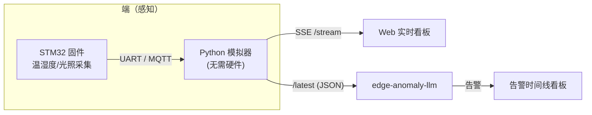

# 🌱 iot-sensor-node · 智慧环境监测终端

> 覆盖「端—边—云」的物联网终端示例：**STM32 固件 + 纯 Python 设备模拟器 + 实时 Web 看板**。
> 无需任何硬件即可演示从「传感器采集 → 上报 → 可视化」的全链路。

[](https://www.python.org)
[](LICENSE)
[](https://docs.python.org/3/library/)

## ✨ 特性
- 🟢 **零外部依赖**：服务端仅用 Python 标准库，通过 SSE（Server-Sent Events）实时推送
- 🔢 **多节点模拟**：实验室 / 温室 / 机房三个终端，温湿度 + 光照，内置异常注入
- 📊 **原生 Canvas 看板**：纯 HTML/JS 画图，离线可用，不依赖任何 CDN
- 🔧 **真实固件参考**：STM32 + FreeRTOS + ESP-AT(MQTT) 工程，与模拟器共用同一数据协议
- 🔗 **可联动**：数据可直接喂给 [`edge-anomaly-llm`](https://github.com/) 做边缘异常检测

## 🏗️ 架构



## 📂 目录结构
```
iot-sensor-node/
├── run.py                 # 启动入口
├── simulator/             # 纯 Python 设备模拟器 + SSE 服务
│   ├── sensor_sim.py
│   └── __init__.py
├── firmware/              # STM32 参考固件（C）
│   ├── main.c  sensor.c  protocol.c  mqtt_at.c
│   ├── CMakeLists.txt
│   └── README.md
└── dashboard/
    └── index.html         # 实时看板（原生 Canvas）
```

## 🚀 快速开始

### 1）零依赖运行（软件模拟，推荐先跑这个）
```bash
python run.py
# 看板:    http://localhost:8000/
# 数据流:  http://localhost:8000/stream   (SSE)
# 快照:    http://localhost:8000/latest   (供其他项目消费)
```
可选环境变量：`SENSOR_PORT`（端口，默认 8000）、`SENSOR_INTERVAL`（采样间隔秒，默认 1.0）。

### 2）固件协议联调（无需硬件）
```bash
cd firmware
gcc main.c sensor.c protocol.c mqtt_at.c -o node_demo -DPC_BUILD
./node_demo
# 输出: {"id":"node-A",...,"temp":24.12,"hum":55.3,"lux":418.0,"anomaly":0}
```

### 3）烧录到真实板子
见 [`firmware/README.md`](firmware/README.md)：用 STM32CubeMX 生成初始化，替换驱动桩，arm-none-eabi 编译后烧录。

## 📡 数据协议
与模拟器输出字段一致（详见 [`firmware/protocol.h`](firmware/protocol.h)）：
```json
{"id":"node-A","name":"实验室-01","ts":1710000000000,
 "temp":24.12,"hum":55.3,"lux":418.0,"anomaly":false}
```

## 🧭 在「端—边—云」中的位置
本项目负责**端侧采集与可视化**。配合：
- [`edge-anomaly-llm`](https://github.com/) — 边/云侧异常检测 + 大模型告警解读
- [`llm-rag-kb`](https://github.com/) — 本地知识库问答（大模型应用）

## 🗺️ 路线图
- [ ] 增加 CO₂ / 土壤湿度等更多传感器类型
- [ ] 模拟器支持串口直连真实固件（pyserial）
- [ ] 看板增加历史回放与导出 CSV

## 📄 License
[MIT](LICENSE) © 2026 Wooji
